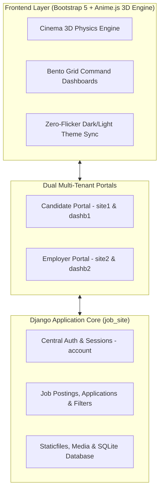

<div align="center">

# 🎬 Livik Jobs — Cinema-Grade Job Portal

### **Full-Featured Multi-Tenant Employment Platform Powered by Django & "Absolute Cinema" Visual Engine**

[](https://github.com/Patel-Trupt28/livik-jobs/actions/workflows/ci.yml)
[](LICENSE)
[](https://www.python.org/)
[](https://www.djangoproject.com/)
[](https://animejs.com/)
[](https://getbootstrap.com/)
[](README.md#-testing--uat)

<p align="center">
  <a href="#-overview">Overview</a> •
  <a href="#-system-architecture">Architecture</a> •
  <a href="#-key-features">Features</a> •
  <a href="#-system-modules">Modules</a> •
  <a href="#-quickstart-guide">Quickstart</a> •
  <a href="#-testing--uat">Testing</a> •
  <a href="#-contributing">Contributing</a>
</p>

</div>

---

## 🌟 Overview

**Livik Jobs** is an enterprise-grade, multi-tenant employment platform engineered with Django and elevated by an "Absolute Cinema" visual experience. It features custom **Anime.js 3D physics engines**, interactive **Bento Grid** command hubs, seamless **Dark/Light Mode synchronization**, and dedicated portal ecosystems for both Job Candidates and Enterprise Employers.

```text
Candidates (Discovery & Applications) ──┐
                                       ├──► Django Multi-App Core ──► SQLite / PostgreSQL
Recruiters (Job Posting & Pipelines)  ──┘
```

---

## 🏗️ System Architecture



---

## 🌟 Key Features

### 🎥 1. Absolute Cinema 3D Engine
* **Interactive 3D Tilt**: Mouse-reactive perspective cards with natural spring snapback physics.
* **Ambient Floating Field**: Floating kinetic particles and zero-gravity badges.
* **Specular Glare Tracking**: Radial lighting highlights that follow cursor velocity in real time.
* **HUD Rolling Counters**: Smooth numerical easing for portal statistics and metric rollups.
* **Cyber Mesh Perspective**: Deep retro-futuristic perspective grid background.

### 🌓 2. Unified Dark Mode Ecosystem
* **Zero-Flicker Bootstrap**: Instant DOM layout theme rendering before CSS execution.
* **Cross-App Sync**: Synchronized persistence via `localStorage` and cookies spanning Candidate, Employer, and Dashboard spaces.
* **Cinema Contrast Tokens**: Custom-crafted glassmorphism surfaces, neon cyan/amber accents, and crisp readability across dark and light states.

### 🍱 3. Bento Grid Command Hubs
* High-density, asymmetrical Bento layouts on both Candidate & Employer command hubs.
* Live-updating activity feeds, skill badges, salary benchmarks, and application velocity cards.

---

## 🧩 System Modules

The application is structured into modular Django applications:

| App | Description | Key Routes |
| :--- | :--- | :--- |
| **`site1`** | Candidate Public Discovery Portal | `/`, `/index/`, `/about/`, `/jobs/` |
| **`site2`** | Employer Enterprise Portal | `/site2/`, `/site2/emp_jobs/`, `/site2/pricing/` |
| **`dashb1`** | Candidate Operations Dashboard | `/dashb1/`, `/dashb1/profile/`, `/dashb1/applications/` |
| **`dashb2`** | Employer Hiring Pipeline Command | `/dashb2/`, `/dashb2/post_job/`, `/dashb2/applicants/` |
| **`account`** | Central Authentication & Session Control | `/account/login/`, `/account/register/`, `/account/logout/` |

---

## 🚀 Quickstart Guide

### 1. Prerequisites
* Python 3.10+ (Recommended Python 3.12 / 3.13)
* Git

### 2. Clone the Repository
```bash
git clone https://github.com/Patel-Trupt28/livik-jobs.git
cd livik-jobs
```

### 3. Create & Activate Virtual Environment
```bash
# Windows
python -m venv .venv
.venv\Scripts\activate

# macOS / Linux
python3 -m venv .venv
source .venv/bin/activate
```

### 4. Install Dependencies
```bash
pip install -r requirements.txt
```

### 5. Apply Migrations & System Checks
```bash
cd job_site
python manage.py migrate
python manage.py check
```

### 6. Start Development Server
```bash
python manage.py runserver
```

Open your browser and navigate to:
* **Candidate Portal**: [http://127.0.0.1:8000/](http://127.0.0.1:8000/)
* **Employer Portal**: [http://127.0.0.1:8000/site2/](http://127.0.0.1:8000/site2/)

---

## 🧪 Testing & UAT

This codebase includes comprehensive User Acceptance Testing covering:
- Authentication & role-based routing (Employer vs. Candidate)
- Dark mode cookie & `localStorage` persistence
- Anime.js asset availability & 3D script initialization
- Job posting, search filtering, and application submission flows
- Navigation route integrity across all 4 sub-applications

> **UAT Validation**: **37 / 37 Passed (100%)**

---

## 📁 Project Structure

```text
livik-jobs/
├── .github/               # GitHub Actions CI workflow & issue templates
│   ├── workflows/ci.yml
│   └── ISSUE_TEMPLATE/
├── .gitignore
├── requirements.txt
├── LICENSE
├── CONTRIBUTING.md
├── CODE_OF_CONDUCT.md
├── SECURITY.md
├── README.md
└── job_site/
    ├── manage.py
    ├── job_site/          # Core Django project settings & URLs
    ├── account/           # Authentication models & views
    ├── site1/             # Candidate frontend templates, static & views
    │   └── static/
    │       ├── css/cinema-ui.css
    │       └── js/cinema-effects.js, cinema-darkmode.js, anime.min.js
    ├── site2/             # Employer frontend templates, static & views
    ├── dashb1/            # Candidate dashboard
    └── dashb2/            # Employer hiring dashboard
```

---

## ☁️ Deployment Guide

### Deploying to Vercel (Recommended)

This repository is optimized for zero-config deployment on [Vercel](https://vercel.com):

1. **Import Project**: In Vercel, click **Add New...** > **Project**, select your `livik-jobs` repository.
2. **Framework Preset**: Select **Other** (leave Root Directory as `./` default).
3. **Build & Output Settings**:
   - Vercel automatically detects `vercel.json` and uses `api/index.py` serverless WSGI runtime.
4. **Environment Variables** (Optional):
   - `DEBUG`: `False` (for production)
   - `SECRET_KEY`: A secure random string for Django
   - `DATABASE_URL`: (Optional) PostgreSQL connection string (from Neon, Supabase, Railway, etc.)
5. Click **Deploy**!
   - Static files are compressed and served by **WhiteNoise** with caching.
   - If no external database is configured, an ephemeral SQLite database is initialized in writable `/tmp` space.

### Deploying to Netlify

Netlify is also supported out-of-the-box via `netlify.toml` and `netlify/functions/app.py`.

---

## 🤝 Contributing

Contributions are welcome! Please read [CONTRIBUTING.md](CONTRIBUTING.md) and [CODE_OF_CONDUCT.md](CODE_OF_CONDUCT.md) before submitting pull requests.

1. Fork the Project
2. Create your Feature Branch (`git checkout -b feature/CinemaEnhancement`)
3. Commit your Changes (`git commit -m 'feat: add cinema particle effect'`)
4. Push to the Branch (`git push origin feature/CinemaEnhancement`)
5. Open a Pull Request


---

## 📄 License

Distributed under the **MIT License**. See [`LICENSE`](LICENSE) for details.

---

<div align="center">
  <sub>Maintained by <a href="https://github.com/Patel-Trupt28">Patel-Trupt28</a>. If you love the Cinema UI, give it a ⭐ on GitHub!</sub>
</div>
